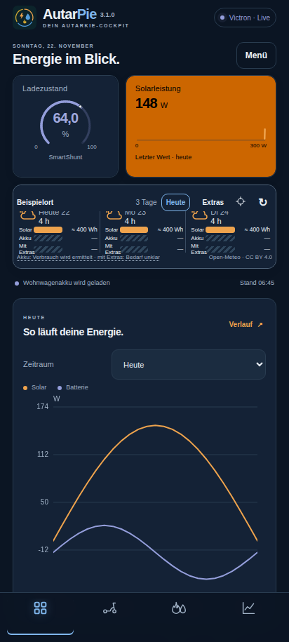
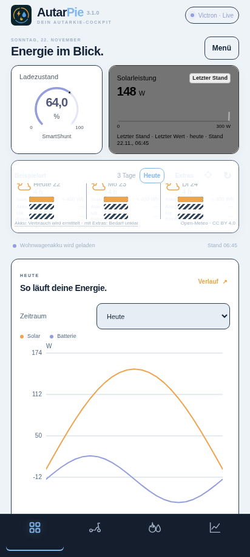
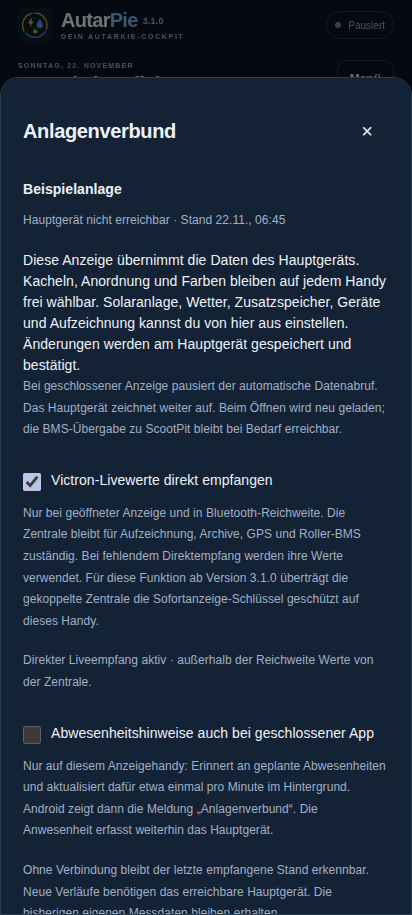
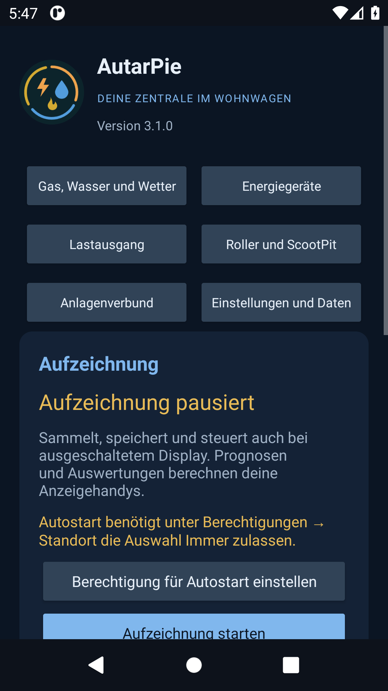

# AutarPie 3.1.0

**Das lokale Cockpit für autarkes Leben.** Solar und Stromverteilung, Wohnwagenakku, E-Scooter, Modellbau, Gas und Wasser in einer gemeinsamen App. AutarPie führt **Watt’n’Pit und WohnPit** weiter.

**[AutarPie 3.1.0 als APK herunterladen](https://github.com/Tim-Gurke/AutarPie/releases/download/v3.1.0/AutarPie-v3.1.0.apk)** · [Einrichtung und Bedienung](docs/AUTARPIE-3.md) · [Update und Prüfgrenzen](docs/changes-3.1.0.md) · [Vollständige Versionshistorie](CHANGELOG.md)

Android 8 oder neuer; das Cockpit benötigt einen aktuellen Android-System-WebView. Kein Pflichtkonto, keine Werbung. Mess- und Lerndaten werden lokal gespeichert; eine freiwillige verschlüsselte Sicherung kann in einem selbst gewählten lokalen oder unterstützten Online-Ordner abgelegt werden. Der optionale Wetterabruf verwendet Open-Meteo. Der Anlagenverbund überträgt Daten verschlüsselt im lokalen WLAN.

## Ansichten

| Aktuelles Wetter neben unabhängigen Messkacheln | Noch nicht aktueller Diagrammstand |
| --- | --- |
|  |  |

| Optionaler Direkt-Liveempfang auf der Anzeige | Native Zentrale auf Android 11 |
| --- | --- |
|  |  |

Aufnahmen aus den Android- und Browser-Oberflächenprüfungen für 3.1.0 mit neutralen Geräte- und Versionsattrappen. Die Aufnahmen sind kein Funk- oder Hardwaretest. Eigene Farben und Layouts bleiben beim Update erhalten.

## Ein Cockpit, mehrere Anwendungen

- **Übersicht:** frei zusammenstellen, was gerade gebraucht wird – auch Werte aus E-Scooter, Modellbau, Gas und Wasser.
- **Solar & Speicher:** Anlage, Batteriebilanz, PV-Spannung, Lastausgang, Wetter und Prognose.
- **E-Scooter:** BMS-Werte, Speicherinhalt, Ladeweg, Ladeplanung und Sondernutzung.
- **Gas / Wasser:** Beschaffungen, Flaschenwechsel, korrigierter Vorrat und gelernter Bedarf.
- **Modellbau:** 608PD-Livewerte, begrenzte bestätigte Bedienfunktionen und Einordnung externer Batterieladung.
- **Verlauf, Geräte, Einstellungen:** Messungen, Phasenzeitleiste, Verbindungen und gemeinsame Konfiguration.

Alle Bereiche sind oben über **Menü** erreichbar. Untere Kurzwahlen lassen sich ein-/ausblenden und ordnen; Ziehen und Pfeile zeigen die neue Reihenfolge sofort im Dialog. Android-Zurück führt durch die geöffneten Einstellungs- und Menüebenen. Eigene benannte Dashboards können leer beginnen oder eine vorhandene Ansicht kopieren. Raster, Kachelgrößen und Hoch-/Queranordnungen bleiben gerätelokal. Kachelentfernen fragt nach; die Darstellungsgröße verlangt ausdrückliches Speichern.

Gemeinsame Bereichsfarben und weiche zwei-/dreifarbige Skalen sind zentral einstellbar. App- und Kachelhintergründe unterstützen eine oder zwei Farben mit Verlaufwinkel 0–360°. Einzelne Kacheln dürfen davon abweichen. Optional erhält jedes Dashboard ein eigenes Farbdesign. Die Farbauswahl startet beim aktuellen Farbton und bietet App-Farben sowie automatisch gemerkte eigene Mischfarben.

## Zentrale, Anzeige oder eigenständig

| Rolle | Aufgabe |
| --- | --- |
| Zentrale | Mess- und Wettergrundlagen erfassen, speichern und verteilen; native Bedienoberfläche und bestätigte Steuerung |
| Anzeigehandy | Cockpit, Diagramme, Prognosen, Verbrauchslernen und eigene Dashboards aus den Zentraldaten berechnen |
| Eigenständig | Erfassung, Berechnung, Planung und Cockpit auf einem Gerät ohne Zentrale |

Autostart stellt nach Neustart oder App-Update den gespeicherten Zustand wieder her. Eine pausierte Aufzeichnung bleibt pausiert. Das konkrete Android-Gerät kann erstes Entsperren und zusätzliche Hintergrund-/Bluetooth-Freigaben verlangen. Gemeinsame Zentralfunktionen sind auch von den Anzeigehandys bedienbar, einschließlich Archivabruf und Aufzeichnung.

## Solar, Lastausgang und 608PD

Standort, Aufstellung, Verschattung, Module, Verkabelung und Regler werden gemeinsam eingerichtet. Solarkreise behalten beim Umordnen ihre Kennung und historischen Daten. Mehrere Kreise an demselben Regler teilen sich in der Prognose die eingetragene Strom-/Leistungsgrenze. Jeder mobile Kreis erhält einen eigenen anklickbaren Namen in der Wetterkarte.

Der SmartSolar-Lastausgang ist E-Scooter, Modellbau oder einem anderen Verbraucher zuordenbar. Zustand, Modus, Spannung, Strom und Abschaltgrund werden soweit unterstützt vom Gerät gelesen; Leistung und Energie daraus auf der Anzeige ausgewertet. Regler je Kachel wählen; aktuelle und historische Werte bleiben getrennt. Werte werden nicht nochmals zum bereits am Shunt erfassten Verbrauch addiert.

Die **optionale Rollerautomatik ist zunächst aus**. Ladeziel, Wohnwagenreserve, Tagesziel, Überschussschwellen und Prognosereserve sind variabel. Ein aktives Anzeigehandy erstellt den zeitlich begrenzten Plan; die Zentrale kontrolliert direkte Abschaltbedingungen. Ein Schaltauftrag ist erst mit der tatsächlichen Geräteantwort bestätigt. Ohne gültigen Plan wird zum Ausschalten angefordert. BMS-Empfang allein beweist noch keinen eingesteckten Ladestecker.

Bis zu drei 608PD erhalten getrennte Profile, private Kennungen und eigene Verbindungen. Suche und Einrichtung laufen am erfassenden Handy; Anzeigen bedienen den Ablauf. Die neue direkte Ersteinrichtung verlangt eine Bestätigung am Lader und muss am eigenen 608PD praktisch geprüft werden. Vorhandene Verbindungen aus der eigenen Bluetooth-Aufzeichnung bleiben erhalten. Unterstützt sind die nachgewiesenen Livefelder und das Beenden von Laden/Powerbank-Betrieb. App-Start ist zunächst auf das beobachtete **3S-LiPo-Profil 4,21 V/Zelle / 0,50 A** mit ausdrücklicher Profilbestätigung begrenzt. Powerbank und andere Profile am Gerät starten. Nicht belegte Temperatur-/USB-/CC-CV-Felder werden nicht erfunden.

## Update 3.1.0

**Victron-Livewerte direkt auf der Anzeige:** Optional unter **Anlagenverbund → Verbund öffnen → Victron-Livewerte direkt empfangen** einschalten. Die geöffnete Anzeige hört nur die Sofortanzeige mit; Zentrale, GPS, Archive und Roller-BMS behalten ihre Aufgaben. Bei fehlendem Empfang werden wieder Zentralwerte mit ihrem tatsächlichen Alter verwendet. Die Funktion belegt keinen aktiven Victron-Verbindungsplatz.

**Kleinere Diagrammabgleiche und robuster Diagnoseexport:** Kurze Diagramme benötigen keinen pauschalen 90-Tage-Modellabgleich. Aktuelles Wetter erscheint unabhängig vom noch ladenden Verbrauchslernen; nicht aktuelle Batterieprognosen bleiben einzeln grau. Ein Analysefehler kann als lesbare Teildiagnose exportiert werden, einschließlich verfügbarer Laufzeiten und Messhistorie.

Der [vollständige Freigabelauf 44990747989](https://github.com/Tim-Gurke/AutarPie/actions/runs/44990747989) ist erfolgreich: APK-Bau/Lint, 629 Unit-Prüfungen (347 JavaScript, 275 JVM, sieben Veröffentlichungstests), 1108 native Integrationsprüfungen, 16 Android-Oberflächenprüfungen, acht Sicherungs-/UID-Wiederherstellungsausführungen auf Android 8/11 und 38 verschiedene Browser-Prüfskripte. Darunter sind zwölf Prüfungen verschlüsselter Sofortanzeige-Pakete und neun Diagnoseexport-Prüfungen mit absichtlich gestörten Eingaben. Die ursprüngliche Updatesignatur ist geprüft. Tatsächliche Funkreichweite und Ladezeiten am G5/S20/S10 sind nicht vor Ort gemessen.

**Zuerst die Zentrale, danach alle Anzeigen auf 3.1.0 aktualisieren.** Der Direkt-Liveempfang ist zunächst aus. Messwerte, Kopplungen und eigene Ansichten bleiben erhalten. Für einen ROM-Wechsel die neue vollständige Datensicherung mit übertragbaren Schlüsseln verwenden. [Bedienung und Prüfgrenzen](docs/changes-3.1.0.md).

## Update 3.0.15

**Stabile Kachelfarben beim Nachladen:** Ein frisch vollständig geladener Diagrammstand bleibt bei der nächsten normalen Messwertrevision und während der Hintergrundaktualisierung farbig. „Aktualisierung im Hintergrund“ erklärt den laufenden Abruf. Die normale Aktualisierung läuft weiter. Erste fehlende Daten, Fehler, ausdrücklich ungültige Grundlagen und tatsächlich verspätete Folgeabrufe bleiben grau erkennbar. Die Aktualitätsfrist von höchstens 45 Sekunden zählt ab Abfragestart.

Der [vollständige Freigabelauf 44717836364](https://github.com/Tim-Gurke/AutarPie/actions/runs/44717836364) ist erfolgreich: APK-Bau/Lint, 629 Unit-Prüfungen (347 JavaScript, 275 JVM, sieben Veröffentlichungstests), 1086 native Integrationsprüfungen, 16 Android-Oberflächenprüfungen, acht Sicherungs-/UID-Wiederherstellungsausführungen auf Android 8/11 und 37 verschiedene Browser-Prüfskripte. Die neue Ablaufprüfung kontrolliert 180 fortlaufende Revisionen; die Browserprüfung mehrere aufeinanderfolgende Aktualisierungszyklen sowie tatsächlich verspätete Daten. Die ursprüngliche Updatesignatur bleibt erhalten. Die echte G5-/WLAN-/Victron-Verbindung wurde nicht vor Ort gemessen.

**Zuerst G5/Zentrale beziehungsweise das direkt erfassende Handy, danach S20 und S10/Anzeigen auf 3.0.15 aktualisieren.** Über die vorhandene App installieren. Zentrale und Anzeigen mit 3.0.14 bleiben im Verbund kompatibel; die sichtbare Korrektur benötigt das jeweilige Anzeige-Update. Messdaten, Lernmodelle, Kopplungen, gespeicherte Farben und Layouts bleiben erhalten. [Installation und Prüfgrenzen](docs/changes-3.0.15.md).

## Update 3.0.14

**Bisheriger Lernstand sofort sichtbar:** Die Anzeige liest ihre vorhandenen Verbrauchslerndaten lokal, während der neue Verlaufabgleich noch arbeitet. „Bisheriger Lernstand … wird aktualisiert“ enthält den Zeitpunkt. Wartende Daten erscheinen als „Lernstand wird geladen“, statt eine scheinbar neue Lernphase mit null Stunden zu melden. Akku-Prognosen verwenden weiterhin frische Shuntwerte und die verfügbaren Wetterdaten.

**Begrenzte Modellpakete:** Mehrere kleine Modellseiten teilen sich eine Verbindung; vorhandene unveränderte Tabellen und Rohdatenblöcke werden wiederverwendet. Die Archivvorprüfung erhält eine vom passiven Live-Empfang getrennte Arbeitswarteschlange. Wetteranforderungen warten nicht mehr auf das Gerätearchiv. Alte Gegenstellen bleiben kompatibel.

**Vollständig graue Zwischenstände:** Noch nicht aktuelle Kacheln zeigen Hintergrund, Zahlen, Skalen und Diagramm in Graustufen, mit Textstatus und Zeitpunkt. Jede Kachel bekommt nach ihrem eigenen erfolgreichen Abgleich ihre gespeicherten Farben zurück. Ein fertig geladener Rückblick wird durch sein historisches Datum allein nicht als veraltet markiert. Der bisherige Roller-Hinweis „Alt · Uhrzeit“ bleibt erhalten.

Der [vollständige Freigabelauf 44685933005](https://github.com/Tim-Gurke/AutarPie/actions/runs/44685933005) ist erfolgreich: APK-Bau/Lint, 625 Unit-Prüfungen, 1086 Integrationsprüfungen, 16 native Oberflächen-/Cacheprüfungen und acht Sicherungs-/UID-Wiederherstellungsausführungen auf Android 8/11 sowie 37 verschiedene Browser-Prüfskripte. Der neue Browsertest prüft auch Bildpunkte des grauen Kachelhintergrunds. Die ursprüngliche Updatesignatur bleibt erhalten. G5-/WLAN-/Victron-Laufzeiten wurden dabei nicht physisch gemessen.

**Zuerst G5/Zentrale beziehungsweise das direkt erfassende Handy, danach alle Anzeigen auf 3.0.14 aktualisieren.** Über die vorhandene App installieren, nicht deinstallieren und keine App-Daten löschen. Ein erstmals neu eingerichtetes Anzeigehandy ohne passenden lokalen Lernstand benötigt weiterhin seinen ersten Abgleich. Die bereits veröffentlichte freiwillige tägliche vollständige Sicherung bleibt enthalten. Der G5-Neustart über Automate wurde als funktionierend zurückgemeldet. [Installation, Verhalten und Prüfgrenzen](docs/changes-3.0.14.md).

## Update 3.0.13

Enthalten sind die vorbereitete Archivkorrektur, der schnellere Anzeigeabgleich, die gewünschte Grundeinstellung für neue Installationen und freiwillige tägliche verschlüsselte Sicherungen. Bestehende Messwerte, Geräteverbindungen, Farben und Kachelanordnungen werden beim Update erhalten. Die neue Grundeinstellung wird ausschließlich auf eine leere Neuinstallation angewandt.

Die Archivprüfung liest große Bestände in begrenzten Datenbankabschnitten statt wiederholt einen vollständigen Ergebnissatz. Fehlgeschlagene Anmeldungen erhalten einen begrenzten Neuversuch mit frischem Bluetooth-Client; fehlende Geräteantworten bleiben als Fehler sichtbar. Physische Funkstabilität am eigenen Gerät ist damit weiterhin praktisch zu bestätigen.

Anzeigen bündeln versionierte Rohdaten und übertragen gezielt geänderte Abschnitte. Im neutralen SQLite-/TCP-Vergleich ergaben 81.442 Messwerte identische Energiekurven bei 102 statt 690 Netzwerkaufrufen. Berechnungen laufen weiterhin auf den Anzeigehandys. Die Diagnose trennt Verbindung, Übertragung, Speichern und Berechnung; daraus folgt keine feste Ladezeit für ein bestimmtes Handy.

**Sicherung:** Einstellungen → Daten & Sicherung → **Datensicherung · automatisch / jetzt**. Auf der Zentrale unter **Einstellungen und Daten**. Anfangs ausgeschaltet; frei wählbare Ortszeit, beschreibbarer lokaler oder Android-Online-Ordner, eigenes Kennwort, zwei bis 30 Stände und **Jetzt sichern**. Dateien werden nach dem Speichern vollständig zurückgelesen und geprüft; erst dann werden ältere eigene Stände entfernt. Für den gemeinsamen Verlauf die Zentrale sichern, für eigene lokale Einstellungen bei Bedarf auch die Anzeigen. Beim Wiederherstellen auf einem anderen Handy werden Geräteschlüssel neu im dortigen AndroidKeyStore geschützt. Neue vollständige Sicherungen benötigen 3.0.13 oder neuer; alte Sicherungen bleiben lesbar. [Einrichtung und Wiederherstellung](docs/changes-3.0.13.md).

Der [vollständige Freigabelauf 44046201191](https://github.com/Tim-Gurke/AutarPie/actions/runs/44046201191) ist erfolgreich: APK-Bau und Lint, 613 Unit-Prüfungen, 1.068 Integrationsprüfungen und 22 native Android-Prüfungen auf Android 8/11, außerdem die bisherigen Browser-Szenarien. Dazu gehören echte Android-Speicherfreigaben, Versionserhalt bei Speicherfehlern und eine vollständige Wiederherstellung zwischen getrennten App-UIDs mit echten AndroidKeyStore-Schlüsseln. Kein physischer Funk-, nächtlicher G5-Neustart- oder allgemeiner Cloud-Anbietertest.

**Zuerst die Zentrale beziehungsweise das direkt erfassende Handy, danach alle Anzeigen auf 3.0.13 aktualisieren.** Über die vorhandene App mit ursprünglicher Updatesignatur installieren. Nicht deinstallieren. Alte Anzeigen bleiben über das bisherige Verbundprotokoll kompatibel; neue Übertragung und Darstellung benötigen das eigene Update. Automatische Sicherungen anschließend einmalig am jeweiligen Handy einrichten. Ausgewählte Quellschritte werden vor langen Prüfungen dauerhaft auf GitHub gesichert. [Vollständiger Umfang und Grenzen](docs/changes-3.0.13.md).

## Update 3.0.12

Der [Freigabelauf 43874880586](https://github.com/Tim-Gurke/AutarPie/actions/runs/43874880586) ist vollständig erfolgreich: APK-Bau und Lint, **613 Unit-Prüfungen** (331 JavaScript, 275 JVM, sieben Veröffentlichungstests), **947 native Integrationsprüfungen**, **zwölf Android-Prüfungen** auf Android 8/11 und **36 verschiedene Browser-Prüfskripte**. Die veröffentlichte APK verwendet die ursprüngliche Updatesignatur.

Der Archivdienst verarbeitet Android-Bluetooth-Aufträge und Rückmeldungen unabhängig vom Hauptthread. Eine beschäftigte Oberfläche hält dadurch Diensterkennung und Schreibbestätigungen nicht mehr auf. Der bestehende serielle Protokollablauf und sofortige Verbindungsabbruch bleiben erhalten. Die Bestandsplanung durchgehender Messreihen benötigt weniger Arbeit und erkennt weiterhin dieselben gespeicherten Werte und echten Lücken.

Ein direkter Belastungsvergleich mit 3.0.11 reproduziert die Abhängigkeit vom Hauptthread und prüft ihre Korrektur mit simuliertem Android-Transport. Physische Funkstabilität und sämtliche Verzögerungen zwischen Zentrale und Anzeigehandys sind damit nicht nachgewiesen. [Nachweis und Grenzen](docs/archive-android-dispatch.md).

**Zuerst die Zentrale beziehungsweise das direkt per Bluetooth erfassende Handy auf 3.0.12 aktualisieren.** Anzeigen mit 3.0.11 bleiben kompatibel; ein gemeinsamer Versionsstand wird empfohlen. Über die vorhandene App installieren, Daten und Kopplungen behalten. Anschließend **Fehlende Archivdaten abrufen** verwenden und den Abschluss beider Geräte prüfen. Neue Grundeinstellungen und automatische Sicherungen bleiben für ein späteres Update vorgemerkt. [Update und Bedienung 3.0.12](docs/changes-3.0.12.md).

## Update 3.0.11

**Wetterfarben je Kachel:** Einen Tag wie bisher einmal antippen und unten **✎ Wetterkachel bearbeiten** wählen. Im gemeinsamen Editor lassen sich Schrift/Zahlen, Nebenbeschriftungen, Bedienung, Linien und Balken unabhängig einstellen. Jeder Wettertyp bietet getrennte Farben für seine Bestandteile – etwa Sonne und Wolke oder Wolke und Regentropfen. Die Symbolvorschau zeigt die Auswahl. **Übernehmen** speichert nur diese Kachel auf diesem Dashboard; **Abbrechen** verwirft den Entwurf. Ohne eigene Farbe gilt die passende Vorgabe. Die Ansichtssicherung erhält die Unterschiede zwischen Übersicht, Solar und eigenen Dashboards.

**Roller-Teilmengen bleiben erhalten:** Auch bei größeren Aufzeichnungslücken fließen gültige erfasste Mengen weiter ins Lernen ein. Fehlende Energie wird nicht hochgerechnet. Beobachtete Ladetage, erfasster Mindestanteil und vollständig überwachte Häufigkeitstage bleiben getrennt. Vorhandene Rohdaten werden erneut ausgewertet; Journal und Gesamtenergiebilanz bleiben erhalten. In der Wetterrückschau stehen Solarertrag und Akku jetzt in getrennten Zeilen.

Der vollständige [Freigabelauf 43838698588](https://github.com/Tim-Gurke/AutarPie/actions/runs/43838698588) prüft APK, Lint, Unit- und Integrationsfälle sowie Bedienung im Browser und auf Android 8/11. Der neue Wetterfall prüft unter anderem unabhängige Dashboardfarben, Speichern/Abbrechen, Neustart, Sicherung, einen Tipp pro Tag und lesbare Rückschau bei 150 % Darstellung in beiden Ausrichtungen. Reale Funkstabilität wird dadurch nicht bewiesen.

**Zuerst die Zentrale beziehungsweise das direkt erfassende Handy, danach die Anzeigehandys auf 3.0.11 aktualisieren.** Über die bestehende App mit ursprünglicher Updatesignatur installieren. Daten, Kopplungen und Layouts bleiben erhalten. Anzeigen mit 3.0.10 bleiben für den Verbund kompatibel, erhalten die neuen Wetterfarben und Lernanzeigen aber erst mit ihrem eigenen Update. [Bedienung, Umfang und Prüfgrenzen](docs/changes-3.0.11.md).

## Update 3.0.11

Wetterfarben gelten jetzt unabhängig je Wetterkachel/Dashboard: Schrift und Zahlen, Nebenbeschriftungen, Balken, Linien, Bedienung und einzelne Bestandteile jedes Wettersymbols. Ein Tipp auf den Tag öffnet weiterhin sofort die Details; dort führt **✎ Wetterkachel bearbeiten** in denselben Kacheleditor wie der normale Bearbeitungsmodus. Die Rückschau zeigt Solarertrag und Akkustand in getrennten Zeilen. Vorschau, Speichern/Abbrechen, Neustart und portable Sicherung erhalten die getrennten Farben.

Sicher erfasste Roller-Teilmengen zählen auch bei größeren Funk- oder Aufzeichnungslücken. Fehlende Energie bleibt unbekannt; die Anzeige trennt beobachtete Ladetage und ihren Mindestanteil vom vollständigen Tagesbedarf und ausreichend überwachten Häufigkeitstagen. Vorhandene Rohdaten werden erneut ausgewertet, ursprüngliche Messungen und Journal-Einträge erhalten.

Der [Freigabelauf 43838698588](https://github.com/Tim-Gurke/AutarPie/actions/runs/43838698588) ist vollständig erfolgreich: APK-Bau und Lint, **613 Unit-Prüfungen** (331 JavaScript, 275 JVM, sieben Veröffentlichungstests), **875 native Integrationsprüfungen**, **zwölf Android-Prüfungen** auf Android 8/11 und **36 verschiedene Browser-Prüfskripte**. Die Wettergestaltung wurde im vollständigen Browserlauf zweimal geprüft, einschließlich 150 % Darstellung in Hoch-/Querformat. Keine Aussage über reale Bluetooth-Stabilität oder Stromverbrauch am eigenen Gerät.

**Zuerst Zentrale beziehungsweise direkt erfassendes Handy, danach alle Anzeigen auf 3.0.11 aktualisieren.** Über die vorhandene Installation mit ursprünglicher Updatesignatur installieren. Daten, Kopplungen und Layouts bleiben erhalten. Anzeigen mit 3.0.10 bleiben im Verbund kompatibel; neue Darstellung und Lernberechnungen benötigen dort das eigene Update. [Bedienung und Prüfgrenzen 3.0.11](docs/changes-3.0.11.md).

## Update 3.0.10

Kurze Roller-Zwischenladungen zählen unabhängig vom Ladeziel. Bereits gespeicherte Journale und Rohmessungen werden erneut ausgewertet. Zusammengehörige kurz unterbrochene Abschnitte werden gemeinsam gelernt; begrenzte kleine Messlücken bleiben als Schätzung erkennbar. Die Häufigkeit verlangt ausreichend überwachte Ladeweg-Tage statt exakt lückenloser Abfragezeiten. Letzte aufgezeichnete und letzte fürs Lernen genutzte Ladung werden getrennt angezeigt; größere Lücken bleiben erklärt. Journal-Messungen werden nicht umgeschrieben.

Die Akku-/Extras-Balken unter **Heute** behalten nach Sonnenuntergang ihren gespeicherten Messpunkt während einer Hintergrundaktualisierung. Eine erfolgreich leere Antwort oder ein Anlagen-/Shuntwechsel entfernt ihn weiterhin. Beim Victron-Gerätewechsel wird der alte Client vor dem nächsten Aufbau freigegeben; ausschließlich anfänglicher Status 133 erhält höchstens drei frische Verbindungsversuche mit begrenzter Wartezeit. Das gemeinsame Archivergebnis enthält die Werte und den Erfolg beziehungsweise Fehler aller bearbeiteten Geräte.

Der vollständige Freigabelauf ist unter [Freigabelauf 43743151631](https://github.com/Tim-Gurke/AutarPie/actions/runs/43743151631) dokumentiert: APK-Bau und Lint, 605 Unit-Prüfungen (323 JavaScript, 275 JVM und sieben Veröffentlichungstests), 869 native Integrationsprüfungen, zwölf Android-Prüfungen auf Android 8/11 und 35 verschiedene Browser-Szenarien. Der tatsächliche Gerätewechsel an Regler und Shunt bleibt nach Installation praktisch zu bestätigen; Software-/Emulatorprüfungen beweisen keine Funkstabilität.

**Zuerst die Zentrale beziehungsweise das direkt erfassende Handy, danach die Anzeigehandys auf 3.0.10 aktualisieren.** Die neuen Wetter- und Lernberechnungen laufen auf den Anzeigen beziehungsweise im eigenständigen Betrieb. Anzeigen mit 3.0.9 bleiben für den Verbund kompatibel, erhalten die neuen Berechnungen jedoch erst mit ihrem eigenen Update. Über die vorhandene Installation mit ursprünglicher Updatesignatur installieren; Daten, Kopplungen und Layouts bleiben erhalten. [Änderungen, Bedienung und Prüfgrenzen 3.0.10](docs/changes-3.0.10.md).

## Update 3.0.9

Bluetooth-Empfang, Empfangsfreigaben und Sitzungserhalt laufen unabhängig von lokalen Datenbankprüfungen. Eine langsame oder blockierende SQL-Abfrage hält damit die Verbindungspflege nicht mehr an. GATT-Aufträge bleiben seriell; Abbruch und vorrangige Schaltaufträge schließen Bluetooth unmittelbar. Ein verspäteter Schreibcallback kann nach einer ausgebliebenen Bestätigung keinen Folgeauftrag als erfolgreich ausgeben. Die Diagnose zeigt Schrittzeiten, lokale Prüfdauer und Transportfortschritt auch im nativen Text-Export.

Der neue Vergleichstest sperrt echtes SQLite: Der bisherige Ablauf verliert den simulierten Gegenpart, die Korrektur verarbeitet während derselben Sperre weiterhin Pakete und speichert anschließend den Archivblock ohne Verdopplung. Die Vorprüfung umfasst 320 erfolgreiche gezielte Prüfschritte. Der vollständige [Freigabelauf](https://github.com/Tim-Gurke/AutarPie/actions/runs/43719113816) ist erfolgreich: APK-Bau und Lint, 593 Unit-Prüfungen, 819 native Integrationsprüfungen, zwölf Android-Prüfungen auf Android 8/11 und 35 verschiedene Browser-Szenarien. Der tatsächliche vollständige Abruf an Regler und Shunt bleibt nach Installation praktisch zu bestätigen.

**Zuerst die Zentrale beziehungsweise das direkt per Bluetooth erfassende Handy aktualisieren.** Anzeigen mit 3.0.8 bleiben kompatibel; Datenbankformat und Verbundprotokoll sind unverändert. Über die bestehende Installation mit der bisherigen Updatesignatur installieren. Messdaten, private Verbindungen und Layouts bleiben erhalten. Danach einmal **Fehlende Archivdaten abrufen** ausführen und den vollständigen Abschluss prüfen. [Änderungen, Updateweg und Prüfgrenzen 3.0.9](docs/changes-3.0.9.md).

## Update 3.0.8

**Historische Prüfgrenze:** 3.0.8 begrenzt den Empfangspuffer; die Abhängigkeit von blockierenden lokalen Datenbankprüfungen wird erst mit [3.0.9](docs/changes-3.0.9.md) behoben.

Der Archivempfang gibt Bluetooth-Pufferplatz nach der Verarbeitung frei und unterscheidet einen Transportfehler vom manuellen Abbruch. Gescheiterte Aufzeichnungsstarts bleiben mit Android-Freigaben und Fehlergrund in der Diagnose nachvollziehbar. Die allgemeine **Victron-Liveanzeige sitzt im App-Kopf**; jeder 608PD zeigt seinen eigenen Status.

**Alte Rollerwerte bleiben sichtbar, erscheinen grau und tragen eine Alt-Markierung mit Uhrzeit.** Das Anzeigehandy prüft den ursprünglichen BMS-Zeitpunkt selbst. Erst neue Messwerte heben die Markierung auf. **Modellbau → Journal öffnen** zeigt beobachtete Lade-/Powerbankvorgänge aller gespeicherten Lader, Messlücken und ausschließlich beobachtete Akkuseitenenergie; JSON-Export ist enthalten.

**Gas lernt auch auf Reisen:** Gespeicherte Aufenthaltszeiten werden mit dem damaligen örtlichen Wetter verbunden. Ortswechsel und Zwischenstopps sind kein pauschaler Ausschluss. Unter **Gas und Wasser → Einstellen** lässt sich der Wetterort am erfassenden Handy bei laufender Aufzeichnung per GPS nachführen. Dieses Handy muss beim Wohnwagen bleiben und Standortzugriff **Immer zulassen** haben. Fehlende Ortszeiten und fehlendes Wetter werden getrennt erklärt; die Flaschenwechsel bleiben erhalten.

**Zuerst die Zentrale beziehungsweise das direkt erfassende Handy, danach alle Anzeigen auf 3.0.8 aktualisieren.** Über die vorhandene Installation installieren; Messdaten, bestehende private Verbindungen und Layouts bleiben erhalten. Für Laderjournal, drei Profile und das neue Gaslernen den gemeinsamen Stand 3.0.8 verwenden. Echte Bluetooth-Stabilität, direkte Erstkopplung und nächtlichen G5-Neustart anschließend am eigenen Gerät prüfen. [Änderungen, Bedienung und Prüfgrenzen 3.0.8](docs/changes-3.0.8.md).

## Update 3.0.7

Der 608PD vereinbart vor der Anmeldung größere Bluetooth-Pakete, damit vollständige Messwerte auch auf älteren erfassenden Handys übertragen werden können. Eine erfolgreiche Anmeldung allein reichte dafür bisher nicht aus. Fehler beim Aushandeln der Paketgröße, bei der Dienstabfrage und ein tatsächlich fehlender Dienst werden getrennt angezeigt. Auch ein nicht ladender, erreichbarer 608PD kann „Bereit“ und 0 A melden.

**Zuerst die Zentrale beziehungsweise das direkt erfassende Handy, danach alle Anzeigen auf 3.0.7 aktualisieren.** Vorhandene private Verbindung, Messdaten und Layouts bleiben erhalten; ein neuer Mitschnitt ist bei bereits übernommener richtiger Verbindung nicht nötig. Die tatsächliche Verbindung nach dem Update am eigenen Lader bestätigen. [Änderungen und Prüfgrenzen 3.0.7](docs/changes-3.0.7.md).

Die Verbundschnittstelle bleibt unverändert: Anzeigen mit 3.0.6 bleiben zur Zentrale mit 3.0.7 kompatibel. Für den ersten Verbindungstest genügt deshalb zunächst das Update des tatsächlich per Bluetooth erfassenden Geräts; anschließend wird derselbe Versionsstand auf allen Geräten empfohlen.

## Update 3.0.6

Der Roller kann aus kurzen ausreichend vollständig erfassten Ladungen lernen, obwohl er den übrigen Tag außer Reichweite ist. Energie je Ladung und Ladehäufigkeit bleiben getrennt. Nur vollständig überwachte Ladeweg-Tage oder geeignete bekannte Tage belegen die Häufigkeit; eine Funklücke ist keine Nullnutzung. Eine ausdrücklich gekennzeichnete Wochen- oder eigene Tagesannahme kann überbrücken, bis genügend Grundlagen vorliegen. Bei Rückkehr ersetzt eine konkret geplante Ladung aus frischen BMS-Werten die pauschale Annahme für denselben Zeitraum.

**E-Scooter → Verbrauch lernen** zeigt die Grundlage und führt zur vorläufigen Wochenannahme. Alle ausgewählten Kurzwahlen einschließlich eigener Dashboards verwenden die gemeinsame App-Akzentfarbe; sie bleibt beim Umordnen, bei Farbänderungen und abweichendem Dashboard-Design erhalten. Der historische Haushaltsabgleich aus 3.0.5 bleibt enthalten.

**Die Funktionen aus 3.0.6 bleiben im aktuellen Update enthalten.** Über die vorhandene Installation installieren und anschließend den ersten Abgleich abwarten. Daten, Ladejournal, Kopplungen und Layouts bleiben erhalten. [Änderungen, Bedienung und Prüfgrenzen 3.0.6](docs/changes-3.0.6.md) · [Historisches Verbrauchslernen 3.0.5](docs/changes-3.0.5.md) · [Vollständige Historie](CHANGELOG.md).
