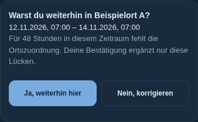
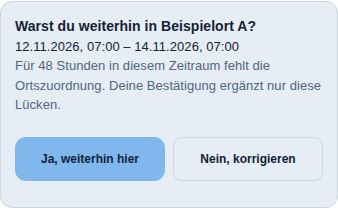

# Ortsbestätigung und Gasbedarf – vorbereitetes Update

Diese Änderungen liegen auf `prepare/gas-stay-confirmation-20261125`. Sie sind
noch nicht in der veröffentlichten APK 3.1.5 enthalten.

## Ortslücken mit Ja oder Nein klären

In **Gas / Wasser** erkennt die Gasansicht Zeiträume ohne ausreichend belegten
Aufenthaltsort und fragt: **„Warst du weiterhin in …?“**. Ort und Zeitraum
sind vorgeschlagen. Mehrere Lücken am selben Ort werden zusammengefasst;
tatsächlich aufgezeichnete Ortswechsel bleiben getrennt.

- **Ja, weiterhin hier:** Nur die fehlenden Ortszeiten werden dem vorgeschlagenen
  Ort zugeordnet. Datum und Ort müssen nicht eingetippt werden.
- **Nein, korrigieren:** Zeitraum prüfen und einen bekannten Ort auswählen oder
  einen anderen Ort beziehungsweise eine Postleitzahl suchen. **Abbrechen**
  verändert nichts.
- Unter **Bestätigte Aufenthalte** lassen sich Bestätigungen später korrigieren
  oder nach einer weiteren Bestätigung entfernen.

Eine Ortsbestätigung ist eine eigene manuelle Angabe. Aufgezeichnete
GPS-Aufenthalte und Beschaffungen werden nicht überschrieben. Treffen später
echte Ortsaufzeichnungen für eine bestätigte Lücke ein, haben diese Vorrang.
Bei überlappenden manuellen Angaben gilt die zuletzt gespeicherte Korrektur.

Vorhandenes historisches Wetter des bestätigten Ortes wird wiederverwendet.
Für einen anderen Ort fordert die Zentrale nur dessen benötigte Wettertage an.
Fehlende Wetterstunden bleiben offen. Eine Ortsbestätigung allein erzeugt weder
historisches Wetter noch einen persönlich gelernten Temperatureinfluss.
Der Wetterrückblick unterscheidet weiterhin unbekannte Ortszeit und bekannte
Aufenthaltszeit mit fehlenden Wetterwerten.

## Durchschnitt, letzte Flasche und Vorschau unterscheiden

Die Gasansicht zeigt drei getrennte Werte mit zwei Nachkommastellen:

| Wert | Bedeutung |
|---|---|
| Üblicher Tagesbedarf | Verbrauch aller gültigen abgeschlossenen Flaschenabschnitte geteilt durch deren Gesamtdauer. Ältere warme Abschnitte bleiben Teil dieses Durchschnitts. |
| Letzter abgeschlossener Flaschenabschnitt | Tatsächlich zugeordneter Inhalt der vorherigen vollen Flasche geteilt durch die Zeit bis zum nächsten Leerwechsel. Vorzeitige Wechsel und Abschnitte mit unklarem Verbrauch werden ausgeschlossen. |
| Erwarteter Bedarf · nächste 24 Stunden | Gespeicherte Verbrauchsfaktoren auf die aktuelle Wettervorhersage angewendet, mit der unten beschriebenen vorsichtigen Untergrenze. |

Die vorhandene Kachel heißt eindeutig **Gas · Üblicher Tagesbedarf**. Zusätzlich
ist **Gas · Bedarf nächste 24 Stunden** frei wählbar. Eigene Übersichten erhalten
keine ungefragt hinzugefügten Kacheln.

## Mindestens den letzten Verbrauch bei anhaltender Kälte ansetzen

Ergab die letzte volle Flasche beispielsweise **1,10 kg/Tag**, wird ein gleich
kalter oder kälterer Prognosetag mit mindestens **1,10 kg/Tag** angesetzt, selbst
wenn ältere warme Abschnitte den langfristigen Durchschnitt senken. Ein höherer
Wert aus dem Wettermodell bleibt erhalten. Die Untergrenze kommt aus der
tatsächlich erfassten Menge und Dauer; 1,10 kg ist kein fest eingebauter Wert.

Verglichen wird die mittlere Heizwitterung ganzer aufeinanderfolgender
24-Stunden-Prognosefenster mit der Wettergrundlage des letzten vollständigen
Flaschenabschnitts. Die stündlichen Bedarfswerte, der Bedarf für **3 / 7 / 14
Tage** und die Reichweite verwenden dieselbe Regel. Ein milder Nachmittag hebt
die Untergrenze eines insgesamt gleich kalten oder kälteren Tages nicht auf.

Fehlt das historische Vergleichswetter oder eine ausreichend aktuelle und
passende Vorhersage, gilt vorsichtshalber ebenfalls mindestens der letzte
Verbrauch. Die Anzeige benennt die fehlende Grundlage und kennzeichnet diese
Annahme. Bei belegbar wärmeren Prognosetagen darf das Wettermodell einen
niedrigeren Bedarf ergeben. Die Untergrenze ist eine konservative Planungsregel,
kein neuer gemessener Verbrauch und kein zusätzlich erlernter Temperaturfaktor.

**Rechenbeispiel:** Eine neue volle 11-kg-Flasche und mindestens 1,10 kg/Tag
ergeben höchstens ungefähr **10 Tage** Reichweite. Bei 1,30 kg/Tag wären es etwa
**8 Tage 11 Stunden**. Ein belastbarer höherer Verbrauch lässt sich nicht allein
aus „es ist kälter“ beziffern; dafür verwendet die App die zugeordneten
Wettergrundlagen und vorhandenen Faktoren. Das sind neutrale Rechenbeispiele,
keine aus einem privaten Gerätejournal ausgelesenen Werte.

Zukünftiges Wetter verändert zukünftigen Bedarf und Reichweite. Der bereits
geschätzte heutige Restvorrat wird dadurch nicht rückwirkend neu gesetzt.
Fehlende Verbrauchsgrundlagen erscheinen weiterhin als **—**.

## Speicherung, Verbund und Updateweg

Die Zentrale speichert Bestätigungen dauerhaft im gemeinsamen Versorgungsjournal
und stellt die Grundlagen bereit. Das Anzeigehandy beziehungsweise der
eigenständige Betrieb führt Verbrauchslernen und Prognose aus. Eine geänderte
Bestätigung oder ergänztes historisches Wetter aktualisiert betroffene
Lernfaktoren. Neue Vorhersagen allein wenden gespeicherte Faktoren an.

Ortsbestätigungen erfordern eine erreichbare Zentrale. Erfolg wird erst nach
deren Speicherbestätigung angezeigt; es gibt keine vorgetäuschte lokale
Erfolgsmeldung. Wiederholte Übertragung derselben Aktion erzeugt keine zweite
Bestätigung. Gleichzeitige Korrekturen werden auf Konflikte geprüft. Die
bestehende Offline-Warteschlange für Beschaffungen und Flaschenwechsel bleibt
unverändert.

Für die neue Bestätigung zuerst die neue Version auf der **Zentrale**, danach
auf **allen Anzeigehandys** installieren. Im eigenständigen Betrieb genügt das
eine Handy. Alte Zentralen werden erkannt; die Bestätigungsaktionen bleiben mit
Updatehinweis deaktiviert. Alte Anzeigen beachten neue Bestätigungen noch nicht
und sollten deshalb ebenfalls aktualisiert werden. Messwerte, ursprüngliches
Journal, Kopplungen, Layouts, Farben und gespeicherte Faktoren bleiben erhalten.

## Prüfstand

Automatisierte Prüfungen verwenden ausschließlich neutrale Orte und erfundene
Einträge: Ortslücken, Ja/Nein/Korrektur/Entfernen, Vorrang tatsächlicher
GPS-Aufzeichnungen, gezielte Wetteranforderungen, Validierung, Konflikte und
wiederholte Übertragung; außerdem kalte/warme Prognosen, Behältergrößen und
unveränderte Rohdaten. Ein echter Browser-Neustart prüft die Wiederverwendung
des gespeicherten Modells ohne erneuten Lernaufruf.

Die Prüfungen kompilieren Produktions-Java ohne APK und verwenden für
Android-Speicherschnittstellen einen Testadapter. Browserprüfungen verwenden
die ausgelieferten Oberflächendateien und eine bestätigende simulierte
Zentrale. Sie ersetzen keinen Funk-, GPS- oder Laufzeittest am G5/S20/S10.
Ein APK-Bau wurde für diesen neuen Umfang noch nicht gestartet.

Der [abschließende Prüflauf 45526725770](https://github.com/Tim-Gurke/AutarPie/actions/runs/45526725770)
für Quellstand `11bf3bf35ae83d0568ab1ce7b15d822ef0ecce0f` ist mit **393
JavaScript-Prüfungen**, **46 Aussagen zur nativen Speicherung und Wetterzuordnung**
sowie den **drei Browserabläufen** für Ortsbestätigung, Gas-/Wasserbedienung und
gespeicherte Lernmodelle erfolgreich. Die Speicherprüfung bestätigt auch, dass
die unterstützten Aktionen zur laufenden Zentralenversion gehören und nicht
bei einer späteren Rückkehr zu einer alten Version fälschlich aus gespeicherten
Daten übernommen werden. Alle drei Prüfjobs sind grün; keiner baut eine APK.
